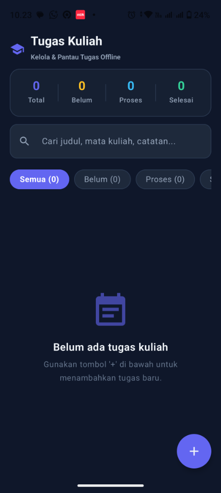
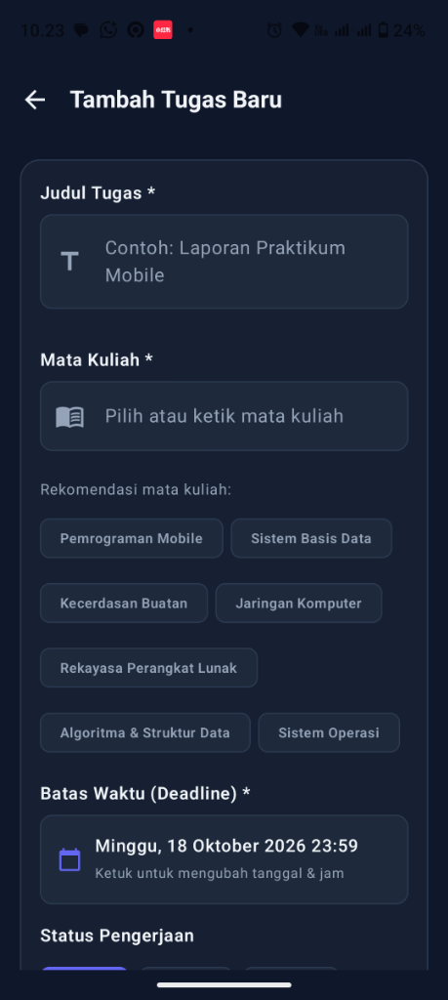
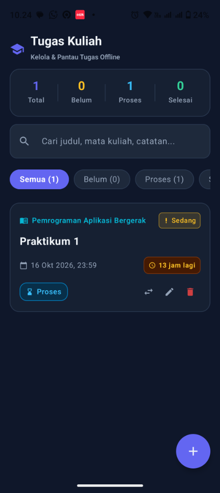
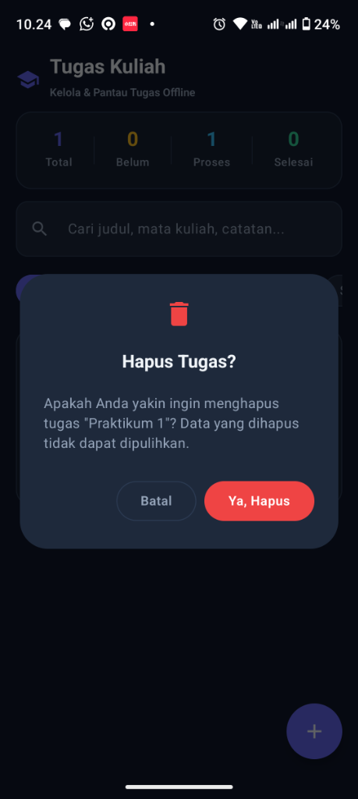

# 📚 Tugas Kuliah - Aplikasi Manajemen Tugas Mahasiswa Offline

Aplikasi Android modern berbasis **Kotlin** dan **Jetpack Compose (Material 3)** untuk mencatat, memantau, dan memperbarui status tugas kuliah secara **100% offline** tanpa memerlukan koneksi internet. Data tersimpan secara aman dan persisten di penyimpanan lokal menggunakan **Room Database**, dibalut dengan **Tema Gelap (Dark Theme)** yang elegan dan nyaman di mata.

---

## 📸 Tangkapan Layar Aplikasi (Screenshots)

  <table>
    <tr>
      <td align="center"><b>1. Layar Utama (Data Kosong)</b></td>
      <td align="center"><b>2. Form Tambah Tugas & Validasi</b></td>
    </tr>
    <tr>
      <td></td>
      <td></td>
    </tr>
    <tr>
      <td align="center"><b>3. Daftar Tugas (Urut Deadline)</b></td>
      <td align="center"><b>4. Dialog Konfirmasi Hapus</b></td>
    </tr>
    <tr>
      <td></td>
      <td></td>
    </tr>
  </table>

---

## ✨ Fitur Utama

- **Penyimpanan Lokal Persisten (Room Database)**: Bekerja penuh tanpa koneksi internet (*100% offline*).
- **Daftar Tugas Terurut Otomatis Berdasarkan Deadline**: Tugas yang batas waktunya paling dekat otomatis berada di posisi paling atas dengan indikator sisa waktu (*misal: 13 jam lagi*).
- **Form Input Interaktif & Validasi Ketat**: Memvalidasi judul tugas (minimal 3 karakter), mata kuliah, serta tanggal dan jam deadline menggunakan Date & Time Picker. Terdapat rekomendasi mata kuliah cepat (*suggestion chips*).
- **Pengaturan Tingkat Prioritas & Status**: Mendukung prioritas *Rendah*, *Sedang*, dan *Tinggi*, serta status pengerjaan *Belum*, *Proses*, dan *Selesai*.
- **Quick Status Toggle**: Status tugas dapat diubah kapan saja dengan 1 sentuhan tanpa harus masuk ke form edit.
- **Dialog Konfirmasi Hapus**: Dialog konfirmasi Material 3 untuk mencegah penghapusan tugas yang tidak disengaja.
- **Filter Status & Statistik Real-Time**: Ringkasan jumlah tugas (*Total*, *Belum*, *Proses*, *Selesai*) beserta chip filter interaktif.
- **Fitur Pencarian Cepat**: Filter pencarian instan berdasarkan judul, nama mata kuliah, atau isi catatan.
- **Tema Gelap Eksklusif (Dark Theme)**: Desain *Deep Slate Dark Mode* yang kontras dan ramah baterai di layar AMOLED.

---

## 💭 Refleksi Singkat Pengembangan

Pengembangan aplikasi **Tugas Kuliah** ini memberikan beberapa wawasan dan pengalaman berharga dalam ekosistem Android modern:

1. **Keandalan Arsitektur Lokal (Offline-First dengan Room & StateFlow)**:
   Menggunakan pola MVVM (*Model-View-ViewModel*) yang memisahkan Entity, DAO, Repository, dan UI State Flow terbukti sangat efektif. Room Database dengan `Flow` memungkinkan pembaruan antarmuka secara reaktif dan instan tanpa perlu memuat ulang data secara manual setiap kali ada perubahan status tugas.

2. **Pentingnya Ketelitian dalam Siklus Hidup Android (Lifecycle & Context Safety)**:
   Salah satu pembelajaran paling bernilai dalam proyek ini adalah saat menangani kompatibilitas runtime pada perangkat fisik. Inisialisasi awal database dan manipulasi tema harus benar-benar terisolasi dari asumsi tipe konteks (seperti menghindari *unsafe casting* `ContextThemeWrapper` ke `Activity`), serta memastikan bahwa seeding data awal berjalan secara asinkron agar tidak memblokir UI thread maupun siklus pembukaan database SQLite.

3. **Efisiensi Desain Menggunakan Jetpack Compose Material 3**:
   Jetpack Compose mempermudah pembuatan UI deklaratif yang dinamis—mulai dari badge countdown deadline, chip filter interaktif, hingga dialog konfirmasi. Penerapan tema gelap penuh juga terasa jauh lebih konsisten dibandingkan pendekatan XML konvensional.

4. **Optimasi Distribusi Aplikasi (Release vs Debug Build)**:
   Proses build release dengan penandatanganan keystore debug menghasilkan APK yang lebih ramping, cepat, dan stabil saat dijalankan di berbagai varian sistem operasi Android OEM (seperti MIUI/HyperOS, ColorOS, dan OneUI).

---

## 🛠️ Teknologi yang Digunakan

- **Bahasa**: Kotlin 2.0.21
- **UI Framework**: Jetpack Compose (Material 3)
- **Database**: AndroidX Room Database 2.6.1 + KSP
- **Arsitektur**: MVVM (Model-View-ViewModel), Repository Pattern, Kotlin Coroutines, StateFlow
- **Minimum SDK**: Android API 24 (Android 7.0 Nougat)
- **Target SDK**: Android API 34 / 35

---

## 📦 Instalasi File APK

File APK siap instal tersedia di repositori ini:
- **`TugasKuliah.apk`** (Versi Release teroptimasi - Sangat Direkomendasikan)
- **`TugasKuliah-debug.apk`** (Versi Debug)

Cukup salin file `.apk` ke ponsel Android Anda, aktifkan izin instalasi dari sumber tidak dikenal jika diminta, dan aplikasi langsung siap digunakan!
